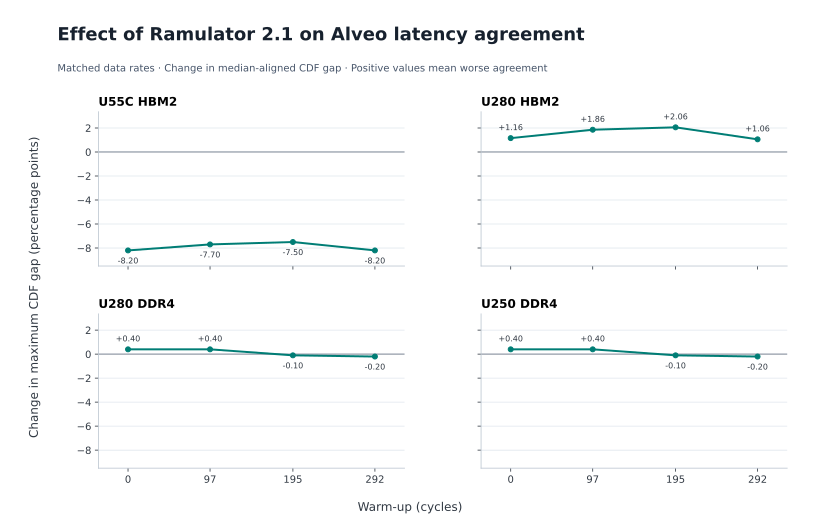

# Alveo memory latency report · 27 November 2026

This report compares hardware, Ramulator 2.0 and Ramulator 2.1 on four Alveo
memory targets. It combines the U55C and companion Ferrandi campaigns.
The probe issues 1,000 four-byte reads to one address with one request outstanding. Latency runs from the kernel-side AXI AR handshake
to R at 100 MHz. The simulated address is `0x40000000`. Each profile
was replayed with 0, 97, 195 and 292 extra idle cycles before starting the probe.

## Comparative results

The empirical CDF gap is the largest vertical distance from the hardware
CDF after shifting the simulated median to the hardware median. The ranges
span the four warm-ups. The final column gives the median difference before
alignment.

| Target | 2.0 aligned CDF gap | 2.1 matched aligned CDF gap | 2.1 raw median below hardware |
| --- | ---: | ---: | ---: |
| U55C HBM2 | 10.70 pp | 2.50–3.20 pp | 21 cycles |
| U280 HBM2 | 6.22 pp | 7.28–8.28 pp | 21 cycles |
| U280 DDR4 | 32.40–32.50 pp | 32.20–32.90 pp | 23 cycles |
| U250 DDR4 | 32.40–32.50 pp | 32.20–32.90 pp | 23 cycles |

Ramulator 2.1 improves the U55C HBM2 distribution fit at every warm-up. The
aligned P99 error is unchanged, and the P95 error at warm-up 292 rises from
one to three cycles. U280 HBM2 shows a larger distribution gap at 1800 MT/s,
with a smaller aligned P99 error in three of four warm-ups. At 2000 MT/s, the
gap is 2.30–3.20 pp for U55C and 7.08–8.08 pp for U280. Both XCI-matched DDR4
comparisons show little whole-distribution change. Their aligned P99 error
decreases in three warm-ups and stays the same at warm-up 292. The native
U250 DDR4 profile overshoots hardware P99 by 12–14 cycles after alignment.

[Per-phase statistics](comparison.tsv) · [Hardware capture statistics](hardware-replicates.tsv)

## Profiles and references

| Target | Hardware reference | Primary Ramulator 2.1 profile | Secondary profile |
| --- | --- | --- | --- |
| U55C HBM2 | 1,000 reads from the original U55C-08 reference capture | `matched-rate-1800` retains the 1800 MT/s baseline rate using the adapted native 2.1 timings. | `bambu-2000` uses the pinned U55C template with command recording. |
| U280 HBM2 | 9,000 reads, pooled from nine HACC captures | `u280-hbm2-matched-1800` retains the 1800 MT/s baseline rate and the U280 geometry. It uses the scaled 2.1 HBM2 timings and pseudochannel-scoped refresh. | `u280-hbm2-bambu-2000` uses the pinned native U280 template. |
| U280 DDR4 | 3,000 reads, pooled from three HACC legacy-01 captures | `ddr4-xci-matched-2400` retains the DDR4-2400 XCI parameters, including 8 Gbit ×4, one rank, 64-bit payload, nRFC 421 and nREFI 9363. | — |
| U250 DDR4 | 3,000 reads, pooled from three HACC legacy-02 captures | The same XCI-matched DDR4 model as U280. | `u250-ddr4-bambu-2400` uses the pinned native four-controller U250 template with ×8 organization and nRFC 661. |

The two DDR4 2.0 baselines are byte-identical by warm-up and specify the same XCI
DRAM values. One set of 2.1 XCI replays serves both DDR4 comparisons. Each board
uses its own hardware distribution. `hardware-replicates.tsv` identifies
every HACC trace and reports its quantiles.

Across both campaigns, 24 Ramulator 2.1 replays each completed 1,000 reads.
The target pseudochannels received refreshes every 3.90 µs in the HBM2 replays.
The target DDR4 rank received refreshes every 7.80 µs. Verilator uses the
Ramulator library directly. The comparison covers the selected DRAM model
configurations and leaves Bambu MDPI transport calibration unmeasured.
The warm-up labels represent idle time before starting the probe. Equal
warm-ups can correspond to different absolute refresh phases.

## Figures

| Target | Distribution | Raw quantiles | Warm-up sensitivity |
| --- | --- | --- | --- |
| U55C HBM2 | [CDF](figures/u55c-hbm2-latency-cdf.svg) | [Quantiles](figures/u55c-hbm2-latency-quantiles.svg) | [Warm-ups](figures/u55c-hbm2-warm-up-sensitivity.svg) |
| U280 HBM2 | [CDF](figures/u280-hbm2-latency-cdf.svg) | [Quantiles](figures/u280-hbm2-latency-quantiles.svg) | [Warm-ups](figures/u280-hbm2-warm-up-sensitivity.svg) |
| U280 DDR4 | [CDF](figures/u280-ddr4-latency-cdf.svg) | [Quantiles](figures/u280-ddr4-latency-quantiles.svg) | [Warm-ups](figures/u280-ddr4-warm-up-sensitivity.svg) |
| U250 DDR4 | [CDF](figures/u250-ddr4-latency-cdf.svg) | [Quantiles](figures/u250-ddr4-latency-quantiles.svg) | [Warm-ups](figures/u250-ddr4-warm-up-sensitivity.svg) |

The [overview](figures/alveo-model-agreement.svg) shows how much the aligned
CDF gap changes from 2.0 to 2.1 at each warm-up for the rate-matched profiles.

## Provenance and reproduction

- The [U55C evidence archive](../u55c-ramulator21-ferrandi-20261127/README.md)
  contains the original U55C reference, effective profiles, traces and
  diagnostics. The report reads those inputs in place.
- Ferrandi run `$HOME/thesis/toolchain-ramulator21-dca0351/alveo-replay.NoMGPa`
  reused the Verilator 5.052 binary from `u55c-replay.3ywbP9` and Ramulator
  `3fec8f1cbddf75f4005426fd206342096612d100`. The hashes are in `replay-inputs.sha256` and the [U55C run manifest](../u55c-ramulator21-ferrandi-20261127/ramulator-2.1/provenance.txt).
- `runs/` contains the original latency CSVs. `diagnostics.tar.gz` contains
  the original AXI, DRAM command and run logs. The earlier 2.0 and HACC
  inputs remain at their existing paths and are referenced by `SHA256SUMS`.
- Run `python3 compare.py` with Matplotlib to recreate all English SVG
  figures and summary tables. Run `sha256sum -c SHA256SUMS` to verify the
  report and its input traces.
- To replay, copy `run-replay.sh` and `profiles/` into a fresh Ferrandi
  run directory and pass the path to a complete U55C replay as the first
  argument. Use `python3 archive_runs.py /path/to/campaign` to verify the
  output against the captured AXI and DRAM events before plotting.
- To rebuild the native YAML, set `PYTHONPATH` to the pinned Ramulator
  Python source tree and pass Bambu's `etc/libmdpi/configs/boards` directory
  to `make_alveo_profiles.py`. Regeneration requires PyYAML.
